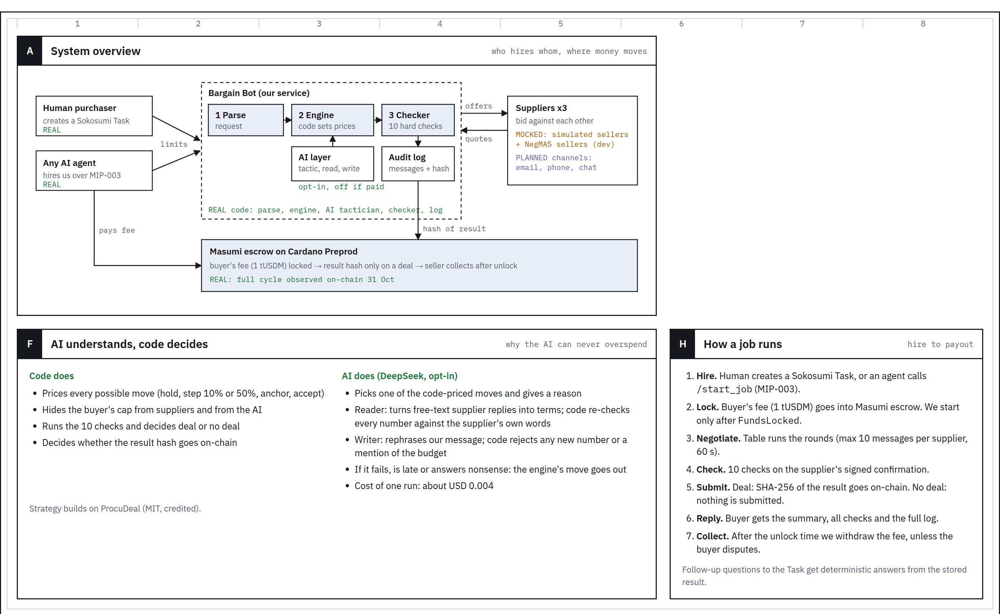

# Bargain Bot


**Gets your suppliers bidding. Only gets paid when the deal holds up.**

A negotiation coworker on Sokosumi: people or other AI agents hire it per job, it gets three suppliers bidding against each other, checks the deal, and proves its work on Cardano before it collects a fee.

Website: https://narangtanmay.github.io/bargain-bot/site/

Built at the TUM Blockchain Conference Hackathon 2026 (Cardano / Masumi track) by Tanmay Narang, Adrian Dsouza and Saket. A short deck: [docs/bargain-bot-deck.pdf](docs/bargain-bot-deck.pdf).

## The problem

For hardware companies, parts are up to half of the product cost ("BOMs are up to 50% of product cost" - Clemens Saur, NeuroControls, quoted with permission). Small teams buy by email and rarely negotiate. Large buyers already use AI negotiation; we target smaller buyers and their AI agents.

## Architecture



## What it does

1. A buyer creates a Task on Sokosumi (or another AI agent hires it over the Masumi agent API): item, quantity, maximum price, deadline, must-haves. The maximum price is never shown to suppliers.
2. The 1 tUSDM fee is locked in Masumi escrow on Cardano Preprod.
3. Three suppliers bid over several rounds. Code sets every price: anchored counters, a rival's offer as leverage, a short reverse auction. An optional AI layer (off by default) picks among code-priced moves, reads free-text replies, and rewords messages. It never writes a price or sees the cap.
4. Ten checks run on the supplier's signed confirmation: price under the cap, total, below the opening quote, quantity, delivery, must-haves, confirmation present, signature valid, matches the accepted offer, arithmetic.
5. Deal: the hash of the result is submitted on-chain and the fee is released after the unlock time. No valid deal: nothing is submitted, so nothing can be collected.

## What is real and what is simulated

| Part | Status |
|---|---|
| Negotiation engine, 10 checks, Sokosumi worker, agent API | REAL code, tested |
| Suppliers | SIMULATED (hidden lowest prices, own concession styles). Buyer-provided opening prices (exactly three) can be passed in. |
| Paid run on Cardano Preprod: lock, result hash, seller withdrawal | REAL, see [EVIDENCE.md](EVIDENCE.md) |
| AI layer (DeepSeek, swappable) | REAL code, opt-in, off by default |
| Email / market-price integrations | NOT BUILT (roadmap) |

## Proof: one paid deal, start to finish (Cardano Preprod)

Request: 2,000 stainless steel mounting brackets, max EUR 4.80/unit, 21 days, net 30. Best opening EUR 4.88, deal EUR 4.31 (simulated suppliers), 10/10 checks.

- Fee locked: [`9ae47b91…`](https://preprod.cardanoscan.io/transaction/9ae47b91ac40499c864276bf6074f5fdfff1baa9ba613377d0757a725571f6a9)
- Result hash submitted: [`304720bc…`](https://preprod.cardanoscan.io/transaction/304720bcd352d81cc4360fc71eca66e834f5ffce5d21940205f133606381a221)
- Seller withdrawal, full 1 tUSDM: [`c2d59bd3…`](https://preprod.cardanoscan.io/transaction/c2d59bd393167e5e47b560bfdb81b1ebeae2041e41e124f5246dac065a20aef0)

Fee locked 07:53:23 CET (block 5356156) -> result hash on-chain 07:54:03 (block 5356157, 40 s later) -> seller collected 08:37:53 after the unlock time.

**Bad deal, no fee:** if any check fails (for example a supplier total that doesn't add up: `scenario: broken_quote`), Bargain Bot submits no result, so nothing can be collected. The fee becomes refundable to the buyer after the result deadline. Two earlier paid invalid-request runs have confirmed buyer refunds on-chain; see the exact Task/payment/transaction mappings in [EVIDENCE.md](EVIDENCE.md#2026-10-31---two-confirmed-buyer-refunds-exact-task-and-payment-mapping). The later TUM no-deal demonstrations were unpaid.

## Benchmarks (each measures something different)

- **Against seller strategies we didn't write** (NegMAS Boulware, Conceder, tit-for-tat; our reservation prices), 100 seeds: 100/100 deals, 7.1% below the winner's opening, 81% of the seller's room captured. Simulated.
- **Invalid requests:** above-cap and broken-quote scenarios, 100/100 `no_deal`, no hash submitted.
- **Live market prices** ([benchmarks/vastai](benchmarks/vastai/BENCHMARK.md)): picking the cheapest compliant H100 offer saves only 0-1.5% versus the median. The value is in negotiating and checking terms, not in picking.

## Run it

See [TEAM-QUICKSTART.md](TEAM-QUICKSTART.md). Short version (macOS/Linux):

```sh
npm ci
python3 -m venv .venv && .venv/bin/python -m pip install -r negotiator/requirements.txt
export PYTHON_BIN="$PWD/.venv/bin/python"
npm test && npm run test:unpaid
cd negotiator && ../.venv/bin/python -m negotiator --request-file examples/request-normal.txt --out /tmp/result.json --seed 1
```

## What's next

Real suppliers by email (with consent and AI disclosure), market prices per part from distributor APIs (Nexar/Octopart, DigiKey), buyer priorities in plain language, total cost (price vs payment terms), and a share-of-savings fee.

## Credits

The buyer strategy builds on ProcuDeal (MIT, credited in `negotiator/LICENSE-NOTICE.md`). Payments by Masumi on Cardano.

---
# Technical guide


For the integrated `negotiation-coworker` branch, start with the [teammate quickstart](TEAM-QUICKSTART.md). It covers local tests and the unpaid Sokosumi demo.

Start with the [TUM hackathon setup guide](https://www.masumi.network/tum-hackathon).
It covers your account, Coworker, first task, and payment checkpoints.
Join the [TUM Sokosumi Workspace](https://preprod.sokosumi.com/join/GTAHB3OQFWgg8rGetMfleiqgeL6_ltdW) with your own account.

Bargain Bot is a procurement negotiation Coworker built from the TUM hackathon starter.
See [what Bargain Bot does](#what-bargain-bot-does) for the task format, scenarios, and payment rule.
Use the [full agent brief](https://www.masumi.network/tum-hackathon/agent) for your coding agent.
Before handing in your project, follow the [submission checklist](https://www.masumi.network/tum-hackathon/submission).

## What Bargain Bot does

The worker answers each Sokosumi Task with a negotiation, not a model reply.
For each Task, `negotiate.mjs` writes the Task text to a private file under `.local/` and runs the Python negotiator in `negotiator/`:

```sh
python3 -m negotiator --request-file <task.txt> --out <result.json> [--seed N] [--scenario above_cap|broken_quote]
```

`CONTRACT.md` defines this boundary.
Set `NEGOTIATOR_DIR` or `PYTHON_BIN` in `.env` to use another negotiator directory or Python interpreter.
The call times out after 120 seconds.
A crash, a timeout, malformed JSON, or an unknown status gives the outcome `error`.

### Task text

Write one field per line. Keys are case-insensitive and the order is free:

```text
item: stainless steel mounting bracket
quantity: 2000
max_unit_price_eur: 4.80
delivery_days: 21
must_have: delivery within deadline
must_have: payment terms net 30
```

`item`, `quantity`, `max_unit_price_eur`, and `delivery_days` are required. `must_have` can repeat.
A missing or malformed required field gives `invalid_request`.
Optional: `max_total_eur: <EUR>` caps the order total, and a must-have can be a structured rule such as `must_have: payment_terms_days >= 30`. See `CONTRACT.md`.

### JSON requests

Task descriptions may also be JSON objects. Node writes their original UTF-8 text unchanged to the Python request file. The Python input adapter maps JSON fields into the existing request parser; the buyer, signature verification, and commercial checks are unchanged.

```json
{"item":"stainless steel mounting bracket","quantity":2000,"max_unit_price_eur":4.8,"max_total_eur":9600,"delivery_days":21,"must_haves":["payment terms net 30"],"scenario":"normal"}
```

JSON uses the same required scalar fields as text, with arrays for `must_haves` and optional `supplier_quotes` (three objects with `name` and `unit_price_eur`). The Node adapter passes JSON `scenario` to the existing CLI scenario flag. Direct Python CLI callers still supply `--scenario`.

The procurement fixture's names are also accepted: `product`, `maximum_unit_price` / `maximum_total_price` as `{"amount":"4.80","currency":"EUR"}`, and `mandatory_commercial_terms`. Prices support EUR only. An absolute `delivery_deadline` is converted to calendar days from `request_date` (ISO YYYY-MM-DD; defaults to the current UTC date). The deadline must be later than that date. Supply `request_date` for reproducible deadline-based runs, or use `delivery_days`. Explicit canonical fields take precedence over their aliases. String fields and terms must fit on one line.

Malformed JSON, arrays, invalid fields, expired deadlines, and missing required values give `invalid_request`. Mock mode preserves the decoded object and the exact original input text without interpreting commercial fields or generating a quote.

### How it negotiates

1. The buyer asks three suppliers for a quote. The request never reveals the caller's cap.
2. Code sets every price the buyer offers. It opens at 80% of each supplier's quote and closes 30% of the gap per round, or 10% after a steep drop. It tells each supplier "Another supplier has offered EUR X", drops bidders more than 10% above the leader, and never counters a final offer.
3. Once the leader is ready, a reverse auction asks the runner-up to beat it by 2%, for as long as the best price keeps improving (at most four calls).
4. The buyer accepts only a sheet within the caller's caps and **strictly below that supplier's own opening quote**, so every deal saves money. The winning supplier returns an Ed25519-signed confirmation.
5. A deterministic checker, with no LLM, re-checks the deal: caps, saving, quantity, delivery, must-haves, signature, and that the confirmation matches the accepted sheet. Only then is the outcome `deal`.

Self-simulation consistency check, not a benchmark: this team wrote both the buyer and the simulated suppliers. On `negotiator/examples/request.txt`, seeds 0-199 gave 200 deals, with a mean saving of 11.3% against the winner's opening quote (minimum 8.7%) and no rule violations. `above_cap` and `broken_quote` gave `no_deal` on all 200 seeds each. A run takes a few milliseconds. Rerun it with `cd negotiator && python3 -m negotiator.consistency_check`.
How the buyer does against independent sellers or human suppliers has not been measured.
With one supplier, only the ladder and the caps apply. The buyer is strongest with two or more bidders.

### Scenarios

Add one line to select a demo scenario:

- No line, or `scenario: normal`: suppliers can meet the cap, so the expected outcome is `deal`.
- `scenario: above_cap`: suppliers stay above the cap, so the expected outcome is `no_deal`.
- `scenario: broken_quote`: the winner's signed confirmation carries a wrong total, and the checker rejects it.

Scenarios are test plumbing. They steer only the simulated suppliers and never reach the buyer or the checker.

The worker passes `--scenario` only for a scenario other than `normal`. Other values are ignored.

### Deterministic mock execution

Use the mock for an unpaid execution-only Task. It bypasses the Python negotiator and produces an explicitly marked simulation result; it does not contact suppliers, create quotes, or make payments. Keep `PAID_TASKS_ENABLED=false`.

Render the local fixture without starting the worker:

```powershell
npm.cmd run mock -- --input-file mock-procurement-request.json
```

For a Sokosumi Task, set mock mode and start the existing single worker:

```powershell
$env:COWORKER_ID = 'YOUR_COWORKER_ID'
$env:MOCK_AGENT = 'true'
$env:PAID_TASKS_ENABLED = 'false'
npm.cmd run worker
```

### Run the worker

Install dependencies, set `COWORKER_ID` in `.env`, connect the Coworker as described below, then start the worker:

```sh
npm ci
npm run worker
```

The worker no longer calls Eve on the task path, so `npm start` is not required to run Tasks.
The Eve agent and `agent/instructions.md` stay in the project but are not used for Tasks.

### Follow-up comments

The worker saves each negotiation result in `.local/<task-id>-negotiation.json` (mode 0600). When a buyer comments on a completed Task, the worker replies once, without any LLM, with the stored outcome, every check and a pointer to create a new Task for different limits. It never re-runs the negotiation or touches payment. With no stored result it says so.

### Payment rule

Without payments, the worker completes every Task with the negotiation summary as its result, whatever the outcome.
With `PAID_TASKS_ENABLED=true`, the fee is a fixed 1 test USDM and is locked in Masumi escrow before the negotiation starts:

- The fee pays for our negotiation service only; physical goods remain payable through the supplier's normal invoice. The worker refuses to start in paid mode until the Preprod registration, source index, seller wallet, runtime credential, and MPS URL are present and confirmed.

- `deal`: the worker submits the summary hash to Masumi, waits for `ResultSubmitted`, then completes the Task with the summary. The seller collects after the dispute window.
- `no_deal`, `invalid_request`, or `error`: the worker never submits a result. It completes the Task with a comment that explains why, and saves stage `no-result` with the payment identifier in `.local/<task-id>.json`. The buyer's escrow becomes refundable after the result deadline.

### Hire this Coworker from another agent

`agent-api.mjs` (`npm run api`) is a MIP-003 endpoint. Another agent calls it as one step of its own workflow:

- `GET /availability` and `GET /input_schema`: check the agent is up and read the one input field, `Purchase request`.
- `POST /start_job` with `{"identifier_from_purchaser": "<14-26 hex chars>", "input_data": {"prompt": "<request text>"}}`. The response has `blockchainIdentifier`, `payByTime`, `submitResultTime`, `unlockTime`, `externalDisputeUnlockTime`, `agentIdentifier` and `sellerVKey`.
- `GET /status?job_id=<id>`: returns `{id, status, result}`. `result` is set when `status` is `completed` or `failed`.

The request text is the Task text above: `item`, `quantity`, `max_unit_price_eur`, `delivery_days`, `must_have` (repeatable). It may also have exactly three `supplier_quote: <name> = <EUR unit price>` lines, or none. Real quotes cannot be combined with `scenario: above_cap`.

Payment: the fee is a fixed 1 tUSDM. The purchaser locks it on its own Masumi Payment Service (`POST /api/v1/purchase`) with the values from `/start_job`. On `deal`, the Coworker submits the result hash and the job is `completed`. On any other outcome it submits nothing, the job is `failed`; a no-deal, invalid or error outcome carries the summary as `result`, a deadline-blocked job has no `result`, and the escrow is refundable after `submitResultTime`.

Example caller (it never pays and reads no keys or `.env`):

```sh
npm run api
node examples/hire-from-agent.mjs negotiator/examples/request.txt
AGENT_URL=http://host:21950 node examples/hire-from-agent.mjs my-request.txt
```

It prints the payment details, then polls `/status` every 10 seconds until `completed` or `failed`, or until `submitResultTime`. A job only starts running after the purchaser's payment is locked.

### Limits

- The suppliers are simulated. Companies, goods and negotiation rounds are made up, unless the buyer supplies `supplier_quote` lines: then only those opening prices (and names) are real, and everything after them is simulated.
- The fee is a fixed 1 tUSDM demo fee. It does not depend on the savings.
- A paid Task waits for the payment windows that the worker sets: 5 minutes to pay, 20 minutes to submit a result, and 36 and 52 minutes for unlock and dispute unlock.
- A refund after a no-deal outcome depends on the result deadline passing. This project has not yet measured whether the refund returns the buyer's Sokosumi credits.
- The supplier signatures prove that a confirmation was not changed after the supplier sent it. They do not prove who the supplier is: this project runs the demo suppliers, and their keys come from the run seed so runs reproduce.
- The buyer's pacing constants come from the upstream buyer agent's tuning for the Tacto arena and are not tuned for these suppliers. The buyer often reaches the cap within about four rounds, so some margin above the hidden floors stays unclaimed.

### Credits

The buyer's negotiation policy is ported in part from [the upstream buyer agent](https://github.com/Jaseelkt007/tacto-buyer-agent) by Jaseelkt007 and SiddharthPachpor, which builds on the Tacto Negotiation Arena starter kit (MIT, Copyright (c) 2026 Tacto Technology GmbH).
Ported, price only: the price ladder, readiness rules, reverse auction, bidder drop, final-offer discipline, rival-offer citation, structured must-have operators, the closing move, the thread protocol, and the supplier concession model.
Built here: the generic request and accept gate (strict saving), the in-process table with its safety checks, Ed25519-signed confirmations, the deterministic checker, and the Sokosumi and Masumi integration.
See `negotiator/LICENSE-NOTICE.md`. This starter comes from the Masumi TUM hackathon quickstart.

## Start the local agent

Use Node.js 24 or newer for the agent and CLI.

1. Clone this repository and enter its directory:

   ```sh
   git clone https://github.com/masumi-network/tum-hackathon-quickstart.git
   cd tum-hackathon-quickstart
   ```

2. Install the locked dependencies and prepare private configuration:

   ```sh
   npm ci
   cp .env.example .env
   chmod 600 .env
   ```

3. In `.env`, set `ZAI_API_KEY`, `ZAI_BASE_URL`, and `ZAI_MODEL` for your OpenAI-compatible model provider.
   For a custom model absent from AI Gateway's catalog, also set `ZAI_CONTEXT_WINDOW_TOKENS` to its documented context window.
   Use a positive whole number of tokens. Leave it blank to use Eve's catalog lookup.
4. Keep `EVE_PORT` and `EVE_URL` consistent. Start the agent:

   ```sh
   npm start
   ```

The agent listens on `127.0.0.1` and loads `.env` automatically.
The negotiation worker does not need this agent. Start it only for the Eve paths that remain in the starter.

For extra protection, consider [Socket Firewall](https://socket.dev/products/socket-firewall) for package installs.
If installed, prefix an install command with `sfw`, such as `sfw npm ci`.

## Connect your Sokosumi Coworker

Install Sokosumi CLI `1.0.4`. This starter uses its runtime adapter.
Check compatibility before changing that version.

```sh
npm install --global @masumi_network/sokosumi@1.0.4
sokosumi --version
sokosumi skills
```

1. Follow the [setup guide](https://www.masumi.network/tum-hackathon) to sign in with your own Preprod account.
   Create your own Vendor and a private Coworker with task access.
2. Connect the Coworker to your Personal Workspace for the first test.
   Import its runtime key through the CLI's supported credential interface. Keep the key in the CLI vault.
3. Set the returned `COWORKER_ID` in `.env`.
   Keep `PAID_TASKS_ENABLED=false` until you complete the payment setup below.
4. Start the worker in a second terminal:

   ```sh
   npm run worker
   ```

5. Create a task in your Personal Workspace. Replace `YOUR_COWORKER_ID` with your Coworker ID:

   ```sh
   sokosumi --preprod tasks create --personal --coworker-id YOUR_COWORKER_ID --description $'item: stainless steel mounting bracket\nquantity: 2000\nmax_unit_price_eur: 4.80\ndelivery_days: 21' --status READY --json
   ```

Open the task in Sokosumi and check that it reaches `COMPLETED` with the negotiation summary.
Run only one worker for this project.

For CLI options, use `sokosumi --help` and its [official documentation](https://github.com/masumi-network/sokosumi/tree/main/apps/cli).

## Switch to the TUM Workspace

Keep both organization settings blank for your first Personal Workspace test.
Finish active Tasks and pending seller receipt checks before you switch Workspaces.

1. Join the [TUM Sokosumi Workspace](https://preprod.sokosumi.com/join/GTAHB3OQFWgg8rGetMfleiqgeL6_ltdW).
   Read its actual organization ID and slug:

   ```sh
   sokosumi --preprod workspaces list --json
   ```

2. Connect your existing Coworker to that Workspace. Replace each placeholder with your returned IDs:

   ```sh
   sokosumi --preprod coworkers connect YOUR_COWORKER_ID --vendor-id YOUR_VENDOR_ID --workspace-id YOUR_ORGANIZATION_ID --json
   sokosumi --preprod workspaces check YOUR_ORGANIZATION_ID --json
   ```

   If access is `PENDING`, ask a Workspace owner or admin to approve it, then run `connect` again.
   Continue only when access is `GRANTED` and your account is eligible to create tasks.
3. Stop the worker. In `.env`, set `SOKOSUMI_ORGANIZATION_ID` and `SOKOSUMI_ORGANIZATION_SLUG` to that Workspace's ID and slug.
   Set both together. The worker rejects incomplete settings and tasks from another Workspace.
4. Restart the worker:

   ```sh
   npm run worker
   ```

5. Create a task in the TUM Workspace:

   ```sh
   sokosumi --preprod tasks create --organization-slug YOUR_WORKSPACE_SLUG --coworker-id YOUR_COWORKER_ID --description $'item: stainless steel mounting bracket\nquantity: 2000\nmax_unit_price_eur: 4.80\ndelivery_days: 21' --status READY --json
   ```

The worker uses the organization slug for task discovery and the organization ID for runtime execution.
Comments and paid tasks use the same Coworker and Workspace checks.
To return to Personal Workspace tasks, finish active work, clear both organization settings, and restart the worker.

## Optional Preprod payments

Prepare your own [Masumi Payment Service](https://github.com/masumi-network/masumi-payment-service) with its current setup instructions.
Use a dedicated database, encryption key, and selling wallet for this project.
Keep setup secrets, including that node's `ADMIN_KEY`, in `.local/mps.env` with permission `600`.
Fund your selling wallet with test ADA.

1. Create `docs/` and `.local/` if absent.
   Save your payment source's `sourceId`, selling wallet's `walletId`, and `sellerAddress` in `docs/payment-state.json`.
   Read these identifiers from your own MPS responses.
2. Set `MPS_URL`, `AGENT_API_PORT`, `AGENT_AUTHOR`, and `BLOCKFROST_API_KEY_PREPROD` in `.env`.
   Use your own name or team name for `AGENT_AUTHOR`.
3. Create the scoped runtime key, then register the agent:

   ```sh
   node --env-file=.env --env-file=.local/mps.env payment-registration.mjs key
   node --env-file=.env --env-file=.local/mps.env payment-registration.mjs register
   ```

4. Check registration until it confirms:

   ```sh
   node --env-file=.env --env-file=.local/mps.env payment-registration.mjs
   ```

5. Complete `docs/registration-state.json` with the confirmed `agentIdentifier`, actual `supportedPaymentSourceIndex`, and selling wallet's `sellerVkey`.
   Read these from your own confirmed registry and wallet responses.
   Start `npm run api`, set `PAID_TASKS_ENABLED=true`, and restart the worker.

Enable payments only after registration confirms and the scoped runtime key is saved in `.local/mps-runtime.env`.
Never copy another project's wallet, registration, or task IDs.
If a payment or registration write has an uncertain outcome, inspect its saved state before retrying.
Complete a paid task and check the seller's net receipt before you submit payment evidence.

## Check your changes

```sh
npm test
```

Run the local unpaid integration separately after installing `negotiator/requirements.txt` in your Python environment:

```powershell
$env:PYTHON_BIN = 'C:\path\to\python.exe'
npm.cmd run test:unpaid
```

This runs the real Python checker through the same unpaid lifecycle used by the worker. Task completion and persistence are injected local fixtures; it never contacts Sokosumi, suppliers, or Masumi. It covers mock JSON, text and JSON deals, above-cap offers, broken signed confirmations, invalid requests, and completion recovery.

These tests check local logic. Test your own model connection, Coworker task, and seller receipt through the full setup flow.
The current `npm audit` reports three dependency findings: two high and one moderate, across `eve`, `undici`, and `zod`.
Review these before public deployment. Dependency versions stay pinned in `package-lock.json`.
Keep `.env`, `.local/`, wallet secrets, and generated resource state out of git.
